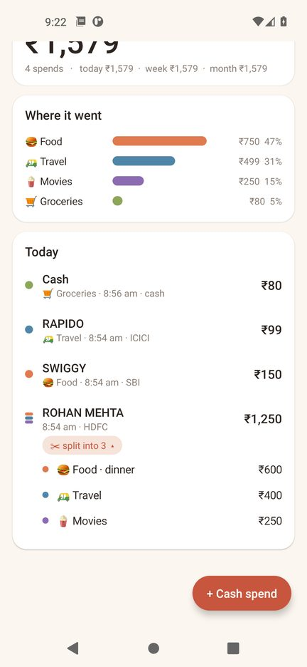
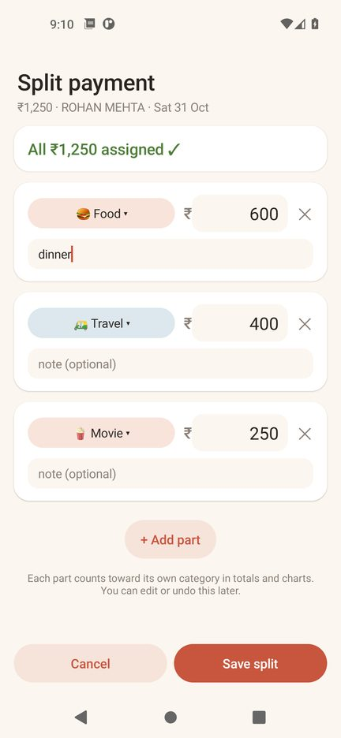
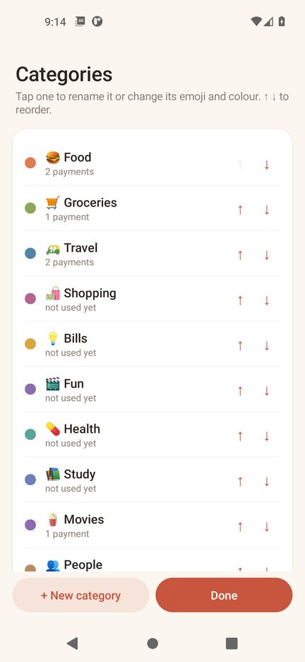
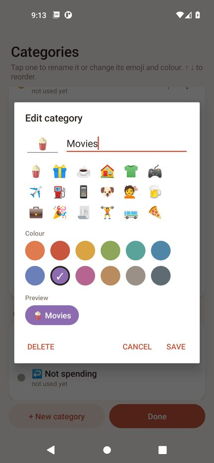

# Kharcha — खर्चा

**Kharcha tracks your spending for you by reading your bank and UPI payment SMS. Everything stays on your phone.**

No sign-up, no bank login, no cloud. Every time your bank texts "Rs 250 debited…", Kharcha logs the amount and who you paid. At night it asks you to tag anything it couldn't sort.

> ⚠️ **Early beta (v1.1.0).** So far it has been tested with unit tests and on the Android emulator, not yet across many real phones and banks. If an SMS from your bank is missed or read wrong, please [open an issue](../../issues) and paste the SMS with personal details removed.

## Download

**[⬇️ Download Kharcha-v1.1.0.apk](https://github.com/mtarvecha660-lgtm/kharcha/releases/latest/download/Kharcha-v1.1.0.apk)** (about 85 KB, Android 8.0+)

You can also grab it from the [Releases](../../releases) page. **Already on 1.0.0?** Just install 1.1.0 over it. It's signed with the same key, so there's no need to uninstall, and all your payments, tags and settings are kept.

## What's new in 1.1.0

- **Split a payment into categories.** Paid a friend back for several things at once? Split it. For example, ₹1,250 to Rohan becomes 🍔 Food ₹600 + 🛺 Travel ₹400 + 🍿 Movies ₹250. Each part counts toward its own category.
- **Edit your categories.** Add your own, rename them, change the emoji and colour, reorder them, or delete one (Kharcha asks where its payments should go).
- **Change the category of anything**, including a single part of a split.

<p>
  
  
  
  
</p>

## Features

- **Automatic tracking**: reads debit SMS from banks and UPI apps (HDFC, SBI, ICICI, Axis, Kotak, PNB, Bank of Baroda, Canara, Union, IDFC, Yes, IndusInd, BOI, Federal, AU, IPPB, Airtel PB, Paytm and more) and pulls out the amount, payee, bank, account ending and reference number.
- **Imports your past 60 days** of SMS the first time you open it, then logs new payments as they arrive.
- **Ignores the noise**: OTPs, promos, failed or declined payments, "will be debited" reminders and duplicate texts. Refunds and reversals get marked.
- **Today / Week / Month view** with a "where it went" bar chart by category. Split payments count by their parts.
- **One-tap categories**: starts with Food, Groceries, Travel, Shopping, Bills, Fun, Health, Study, People and Other. It remembers what you picked for a payee and uses that next time.
- **Your own categories** (⚙ → Edit categories, or "✎ Edit categories" in any category picker): add, rename, change emoji and colour, reorder with ↑ ↓, and delete. Deleting a category that's in use asks where to move its payments ("Other" by default). Renaming moves everything along with it, including the payee rules, and auto-tagging keeps working after a rename.
- **Split payments**: tap a payment → **✂ Split into categories**. Add parts (category + amount + optional note). The remaining amount updates live, **Put rest in…** fills the remainder in one tap, and Save only works once the parts add up exactly (at least 2 parts). The list shows the payment with a **✂ split into N** chip. Tap it to see the parts, and tap a part to change its category. You can edit or undo a split any time.
- **Cash spends**: a "+ Cash spend" button for money that never shows up in an SMS. ATM withdrawals are logged but not counted, so cash isn't counted twice.
- **Nightly reminder** (9:30 PM by default, you can change it) that lists today's untagged payments so you can sort them in a few seconds.
- **Export to CSV** whenever you want your data in a spreadsheet. Split payments are exported as the payment plus one "split part" row per part.
- **Tiny**: about 85 KB, no ads, no trackers, no third-party libraries.

## Privacy

- Kharcha **has no internet permission at all**, so it physically cannot send your SMS or spending data anywhere. You can see this in [`AndroidManifest.xml`](app/src/main/AndroidManifest.xml).
- Messages are read and parsed **only on your device** and saved to a local database inside the app.
- It only reads SMS. It never sends SMS.
- App backup is turned off, so your data isn't copied to the cloud.
- Uninstalling the app deletes all of its data.

## Install on Android

1. On your phone, download **Kharcha-v1.1.0.apk** from the link above or from [Releases](../../releases).
2. Open the file. If Android blocks it, tap **Settings** and turn on **Allow from this source** for your browser or Files app ("Install unknown apps"), then go back and tap **Install**.
3. If Play Protect warns that the app is unknown, tap **More details → Install anyway**. This shows up because the app isn't on the Play Store.
4. Open Kharcha and tap **Allow SMS access**. Allow notifications too if you want the nightly reminder.
5. **Android 13+ and the SMS permission is greyed out or blocked?** Sideloaded apps need one more step. Go to **Settings → Apps → Kharcha → ⋮ (top right) → Allow restricted settings**, then **Permissions → SMS → Allow**.

## Build from source

Requirements: JDK 17 and the Android SDK (platform 34). Android Studio already includes both.

```bash
git clone https://github.com/mtarvecha660-lgtm/kharcha.git
cd kharcha
# point Gradle at your SDK (Android Studio does this for you)
echo "sdk.dir=/path/to/Android/sdk" > local.properties

./gradlew testDebugUnitTest   # SMS parser, split math and database migration tests
./gradlew assembleDebug       # → app/build/outputs/apk/debug/app-debug.apk
./gradlew assembleRelease     # → app/build/outputs/apk/release/app-release.apk
```

On Windows, use `gradlew.bat` in place of `./gradlew`.

**Signing release builds:** copy `keystore.properties.example` to `keystore.properties` and fill in your own keystore, or set the `KHARCHA_STORE_FILE`, `KHARCHA_STORE_PASSWORD`, `KHARCHA_KEY_ALIAS` and `KHARCHA_KEY_PASSWORD` environment variables. If neither is set, `assembleRelease` signs with the debug key, which is fine for testing. Keystores and `keystore.properties` are git-ignored and must never be committed.

Note: an APK you build yourself is signed with a different key than the one on Releases, so uninstall the Releases version before installing your own build.

## Project layout

```
app/src/main/java/app/kharcha/
  core/SmsParser.kt     bank/UPI SMS → amount, payee, bank, account, ref
  core/Categorizer.kt   default categories, payee → category guesses
  core/Split.kt         split math: remaining, validation, "put rest in", totals by category
  core/Schema.kt        database schema + migrations as plain SQL (unit-tested)
  Db.kt                 local SQLite store, de-duplication, refunds, splits, categories
  SplitActivity.kt      split a payment into categories
  CategoriesActivity.kt add / rename / recolour / reorder / delete categories
  Sms.kt                inbox import + live SMS receiver
  MainActivity.kt       dashboard, add/edit, settings, CSV export
  TagActivity.kt        quick tagging of untagged payments
  Reminder.kt           nightly reminder notification
app/src/test/...        SmsParser, SplitMath and Migration unit tests
```

## Your data across updates

The database only ever grows: 1.1.0 adds a `category` table and a `split` table and never drops or rebuilds the existing ones. The upgrade runs once, inside a transaction, and there is no "wipe and start over" fallback. `MigrationTest` builds a 1.0.0 database with sample data, upgrades it with the exact SQL the app runs, and checks that every row is unchanged.

## Contributing

Bug reports with sample (anonymised) bank SMS are the most useful thing right now, since every bank words its messages a little differently. PRs welcome.

## License

[MIT](LICENSE) © 2026 Moksh Tarvecha
